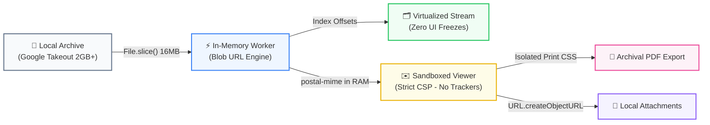

# ViewMBOX

<div align="center">

> **100% In-Browser Streaming MBOX & Google Takeout Viewer**  
> Open, search, and export multi-gigabyte `.mbox` archives locally in your browser. Zero software to install, zero file uploads.

[](https://viewmbox.pages.dev)
[](https://viewmbox.pages.dev)
[](https://viewmbox.pages.dev)
[](LICENSE)

<br/>

👉 **Launch Tool:** [**https://viewmbox.pages.dev**](https://viewmbox.pages.dev)

</div>

---

## ⚡ Architecture: The Zero-Upload Streaming Pipeline

Traditional online email viewers attempt to load the entire archive into contiguous memory at once, crashing the browser tab on files exceeding 50MB. **ViewMBOX** reads archives in 16MB windowed slices via a background Web Worker compiled as an in-memory Blob URL:



---

## 🥊 Feature Comparison: Why ViewMBOX Wins

| Feature | Generic Web Viewers | Cloud Converters (SaaS) | Desktop Clients (Thunderbird) | ViewMBOX |
| :--- | :---: | :---: | :---: | :---: |
| **Max File Size** | ⚠️ ~50 MB (V8 Heap Crash) | ⚠️ ~100 MB Limit | Huge Disk Sync | **Tested up to 2GB on Android Chrome** |
| **Data Privacy** | ❌ May Upload | ❌ Sends Emails to Cloud | Local Storage | **✅ 100% In-Browser (Zero Uploads)** |
| **Offline Operation** | ❌ Fails Offline | ❌ Requires Internet | Requires App Install | **Keeps working with connection off once loaded** |
| **Spy Pixel Protection** | ❌ None | ❌ None | Complex Settings | **✅ Sandboxed CSP Isolation** |
| **Setup Friction** | Zero | Account / Upload Queue | Bulky 200MB+ Install | **✅ Instant Drag-and-Drop** |
| **Cost** | Ad-Laden / Broken | Paid Subscription | Open Source | **✅ Free Forever** |

---

## 🚀 Key Capabilities

- **16MB Windowed Streaming:** Scans archives in 16MB slices in a background Web Worker without loading the entire archive into memory at once.
- **Zero Server Uploads:** 100% client-side execution. Your emails, attachments, and headers never leave your device.
- **Connection-Off Continuity:** Keeps working after initial page load with your network connection turned off (tested with Airplane Mode on Android Chrome).
- **Tracking Pixel Protection:** HTML emails render inside a sandboxed `<iframe>` with a strict Content Security Policy (`default-src 'none'; img-src data: blob:;`) blocking tracking beacons and external spy pixels by default.
- **Dual-Engine PDF Export:** Export individual messages as visual archival PDFs (preserving email styling, tables, and brand logos) or clean vector PDFs.
- **Attachment Extraction:** Extract images, PDFs, spreadsheets, and ZIP archives directly to your Downloads folder with one click.

---

## 📁 Supported Formats & Email Clients

```text
┌────────────────────────────────────────────────────────────────────────┐
│                        SUPPORTED FORMATS                               │
├────────────────────────────┬───────────────────────────────────────────┤
│ Google Takeout (Gmail)     │ Takeout/Mail/All mail.mbox                │
│ Mozilla Thunderbird        │ Profile/Mail/Local Folders/*.default      │
│ Apple Mail                 │ Mailbox Exports (.mbox packages)          │
│ Legacy Mailboxes           │ Eudora, Opera Mail, Pine, Mutt            │
│ MIME Standards             │ RFC 4155, RFC 822, RFC 2822, RFC 5322     │
└────────────────────────────┴───────────────────────────────────────────┘
```

---

## 📊 Verified Benchmarks (Physical Android Mobile Device)

All benchmarks measured live inside Google Chrome on a physical mobile device:

| Archive Type | File Size | Emails Indexed | Ingestion Time | Throughput | Result |
| :--- | :--- | :--- | :--- | :--- | :---: |
| **Real Google Takeout Export** | 23.8 MB | 571 emails | 0.88 s | 27.0 MB/s | **Verified ✅** |
| **Synthetic Stress Archive** | 500.0 MB | 3,778 emails | 11.80 s | 42.4 MB/s | **Verified ✅** |
| **Synthetic Scaling Archive** | 2.00 GB | 16,134 emails | 44.36 s – 47.87 s | 42.8 – 46.2 MB/s | **Verified ✅** |
| **Airplane Mode (After Load)** | **2.00 GB** | **16,134 emails** | **44.36 s** | **46.2 MB/s** | **Verified ✅** |

> **Note on Scope:** Tested on 2.0GB synthetic archive and authentic 571-email Google Takeout export on Android Chrome. Keeps working with your connection off once the page has loaded. Desktop Chrome, Firefox, and Safari performance across larger tiers will be evaluated separately.

---

## 🔒 Privacy & Security Guarantee

1. **Zero Data Transmission:** No email subject, body, header, contact, or attachment is ever sent across the network.
2. **Zero Third-Party Trackers:** No analytics beacons, tracking cookies, or behavioral ad scripts run on private email reading views.
3. **Session Ephemeral:** Closing the browser tab clears all indexed data from system memory immediately.

---

## 📄 License

MIT © [aj00100](https://github.com/aj00100)
